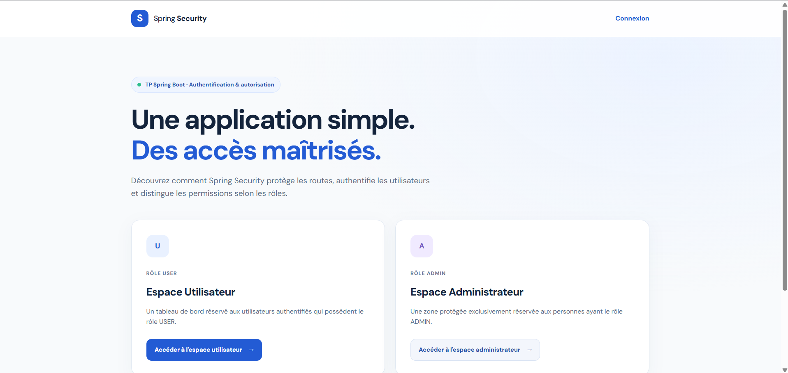
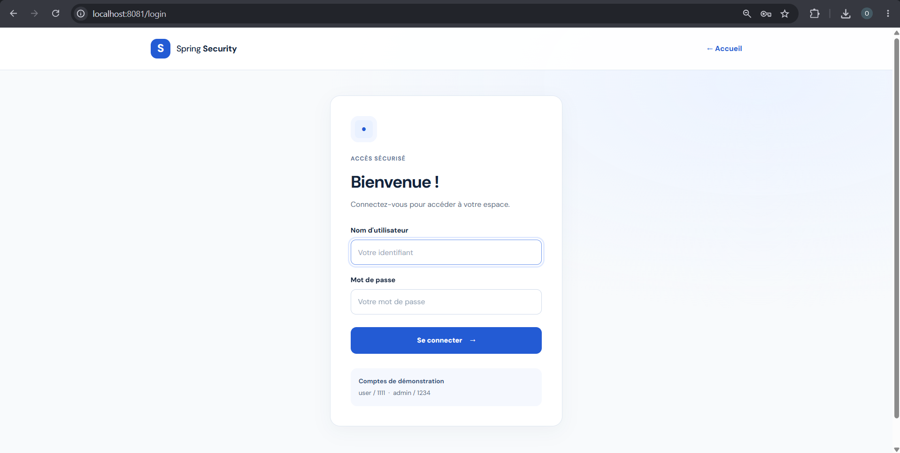
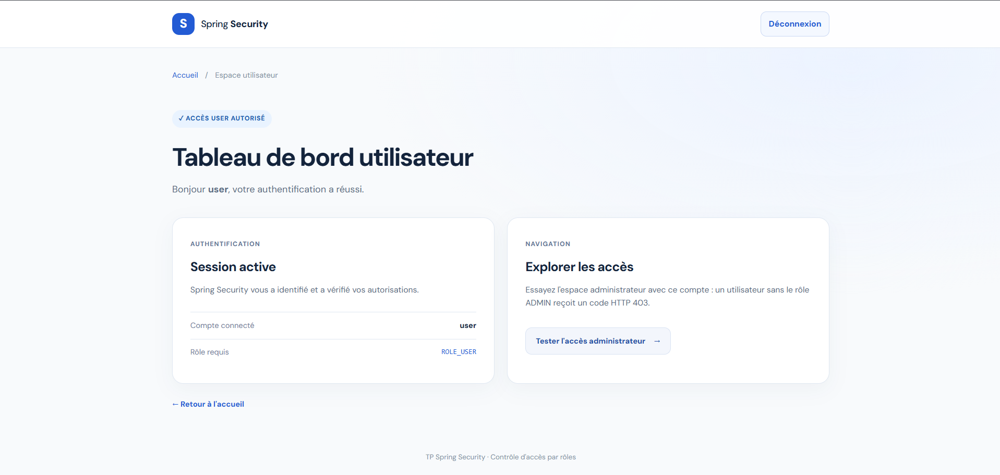
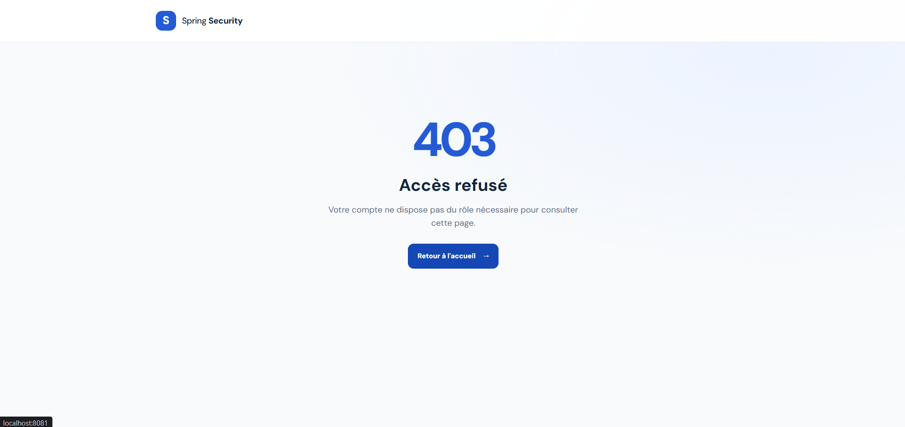
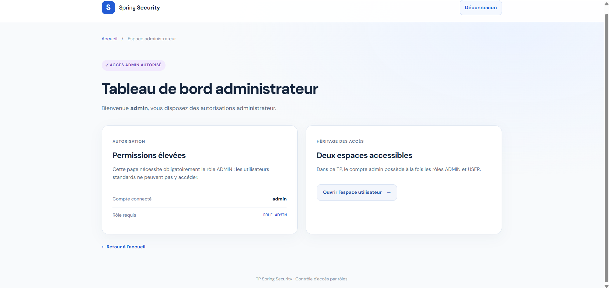

# TP Spring Security — Authentification et gestion des rôles

> Projet pratique Spring Boot : authentification en mémoire, autorisations par rôles (`USER` / `ADMIN`), mots de passe BCrypt, Thymeleaf et formulaire de connexion personnalisé.

**Technologies :** Java 17 · Spring Boot 3.5.16 · Spring Security · Spring MVC · Thymeleaf · Maven · HTML/CSS · JUnit 5 / MockMvc.

## Objectif

Développer une application web sécurisée comportant une page d'accueil publique et deux espaces protégés. Le compte `user` accède à l'espace utilisateur ; le compte `admin` accède aux espaces utilisateur et administrateur.

## Aperçu de l'application

### 1. Page d'accueil — accès public

L'accueil présente les deux espaces et permet de naviguer vers leurs pages protégées.



### 2. Connexion personnalisée

Les visiteurs non authentifiés sont redirigés vers `/login`. Le formulaire Thymeleaf est intégré à Spring Security et transmet un jeton CSRF.



### 3. Tableau de bord utilisateur

Après connexion avec le compte `user`, l'accès à `/user/dashboard` est autorisé.



### 4. Accès interdit — erreur HTTP 403

Un utilisateur ayant uniquement le rôle `USER` ne peut pas consulter `/admin/dashboard` : Spring Security renvoie **403 Forbidden**.



### 5. Tableau de bord administrateur

Le compte `admin` possède les rôles `ADMIN` et `USER`, ce qui permet d'accéder aux deux tableaux de bord.



## Prérequis

- **Java JDK 17** ou **21** (Java 8 n'est pas compatible avec ce projet).
- **Maven 3.9+**, ou un IDE prenant en charge Maven (IntelliJ IDEA, Eclipse, STS).
- Navigateur web ; connexion internet lors du premier téléchargement des dépendances.

Vérifier la version utilisée **par Maven** :

```powershell
java -version
mvn -version
```

Les deux commandes doivent indiquer Java 17 ou une version supérieure compatible. Si Maven affiche Java 8, configurer `JAVA_HOME` vers le dossier du JDK 17.

## Installation et exécution

Ouvrir PowerShell à la racine du projet :

```powershell
cd C:\spring-security-demo
mvn clean spring-boot:run
```

Accès par défaut : **http://localhost:8080/**.

Si le port `8080` est occupé (ce qui a été le cas durant l'exécution du TP), démarrer l'application sur **8081** sans toucher au code :

```powershell
mvn spring-boot:run "-Dspring-boot.run.arguments=--server.port=8081"
```

Dans ce cas, ouvrir **http://localhost:8081/**. Pour arrêter le serveur : `Ctrl + C`.

Pour exécuter les tests :

```powershell
mvn test
```

## Comptes de démonstration

| Compte | Mot de passe | Rôles | Accès |
|---|---|---|---|
| `user` | `1111` | `USER` | `/user/dashboard` |
| `admin` | `1234` | `ADMIN`, `USER` | `/user/dashboard` et `/admin/dashboard` |

> **Attention :** ces mots de passe sont volontairement simples pour le TP. Ils sont **hachés avec BCrypt lors de l'initialisation en mémoire** ; les valeurs de démonstration restent visibles dans le code source. Ne pas utiliser ces identifiants dans un environnement de production.

## Routes et règles de sécurité

| URL | Règle | Résultat attendu |
|---|---|---|
| `/` | `permitAll()` | Accueil accessible sans connexion |
| `/login` | `permitAll()` | Formulaire de connexion |
| `/user/**` | `hasRole("USER")` | Accès USER et ADMIN |
| `/admin/**` | `hasRole("ADMIN")` | Accès ADMIN uniquement |
| `/logout` | Requête POST avec CSRF | Déconnexion et retour à `/` |
| Autres URLs | `authenticated()` | Authentification obligatoire |

La protection CSRF est **maintenue active**. Le formulaire de déconnexion envoie une requête **POST**, plutôt qu'un simple lien GET.

## Réalisation des 10 étapes du TP

| Étape | Réalisation |
|---|---|
| 1. Initialisation | Projet Maven ; dépendances Spring Web, Thymeleaf et Spring Security |
| 2. Sécurité par défaut | Profil optionnel `default-security` permettant d'observer le formulaire natif et le mot de passe généré |
| 3. Contrôleur | `HomeController.java` : `/`, `/login`, `/user/dashboard`, `/admin/dashboard` |
| 4. Vues | `index.html`, `user_dashboard.html`, `admin_dashboard.html` |
| 5. Filtrage HTTP | `SecurityConfig.java` avec bean `SecurityFilterChain` |
| 6. Utilisateurs | `UserDetailsConfig.java` avec `InMemoryUserDetailsManager` |
| 7. Mots de passe | `PasswordEncoderConfig.java` avec `BCryptPasswordEncoder` |
| 8. Connexion | `login.html` personnalisé et `.loginPage("/login")` |
| 9. Validation | Tests manuels (captures ci-dessus) et tests d'intégration JUnit/MockMvc |
| 10. Bonnes pratiques | Moindre privilège, CSRF, déconnexion POST, fixation de session, expiration de session |

### Observer la configuration Spring Security par défaut (étape 2)

Pour reproduire l'état initial **sans supprimer le travail final**, démarrer avec le profil `default-security` :

```powershell
mvn spring-boot:run "-Dspring-boot.run.profiles=default-security" "-Dspring-boot.run.arguments=--server.port=8081"
```

L'application protège alors l'accueil par défaut, affiche le formulaire natif et génère un mot de passe dans la console (`Using generated security password:`). Identifiant : `user`. Arrêter ensuite l'application et relancer sans ce profil pour retrouver la version personnalisée.

## Scénarios de validation

1. Accéder à `/` sans connexion : **accès autorisé**.
2. Cliquer sur l'espace utilisateur sans session : **redirection vers `/login`**.
3. Se connecter avec `user / 1111` : **accès à l'espace utilisateur**.
4. Essayer `/admin/dashboard` avec `user` : **HTTP 403 — Accès refusé**.
5. Se déconnecter : **session terminée** et retour à l'accueil.
6. Se connecter avec `admin / 1234` : **accès aux deux espaces**.
7. Saisir des identifiants incorrects : **message d'erreur de connexion**.
8. Envoyer un POST sensible sans jeton CSRF : **requête refusée**.

Les captures fournies illustrent les principales pages et le refus d'accès. Les tests automatisés inclus permettent de vérifier les règles de sécurité de manière répétable ; ils peuvent être lancés avec `mvn test`.

## Organisation du projet

```text
spring-security-demo/
├── pom.xml
├── README.md
├── docs/
│   └── screenshots/
│       ├── 01-accueil.png
│       ├── 02-connexion.png
│       ├── 03-espace-utilisateur.png
│       ├── 04-acces-refuse-403.png
│       └── 05-espace-administrateur.png
└── src/
    ├── main/
    │   ├── java/ma/fstg/security/
    │   │   ├── SpringSecurityDemoApplication.java
    │   │   ├── config/
    │   │   │   ├── SecurityConfig.java
    │   │   │   ├── UserDetailsConfig.java
    │   │   │   └── PasswordEncoderConfig.java
    │   │   └── web/HomeController.java
    │   └── resources/
    │       ├── application.properties
    │       ├── static/css/style.css
    │       └── templates/
    │           ├── index.html
    │           ├── login.html
    │           ├── user_dashboard.html
    │           ├── admin_dashboard.html
    │           └── error/403.html
    └── test/java/ma/fstg/security/
        ├── SecurityIntegrationTests.java
        └── DefaultSecurityBehaviorTests.java
```

## Points techniques à retenir

- **Authentification** : Spring Security vérifie l'identité via `UserDetailsService`.
- **Autorisation** : `hasRole()` contrôle les accès aux routes selon les rôles de l'utilisateur.
- **BCrypt** : les mots de passe sont comparés à leurs hashes, sans stockage en clair dans le gestionnaire d'utilisateurs.
- **CSRF** : protection conservée pour les formulaires sensibles.
- **Session** : protection contre la fixation de session (`migrateSession`) et délai d'inactivité configuré à 30 minutes.
- **Limite du TP** : les comptes sont conservés en mémoire ; pour une vraie application, prévoir une base de données, des identifiants robustes, HTTPS et une gestion des utilisateurs adaptée.

## Documentation

- [Spring Security — documentation officielle](https://docs.spring.io/spring-security/reference/index.html)
- [Spring Boot — documentation officielle](https://docs.spring.io/spring-boot/index.html)
- [Thymeleaf](https://www.thymeleaf.org/documentation.html)

---

**Conclusion :** ce TP met en œuvre l'authentification, l'autorisation par rôles, le hachage BCrypt et la personnalisation d'une application Spring Boot sécurisée, avec des tests et des captures illustrant les comportements attendus.
